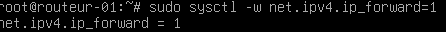
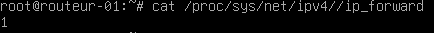
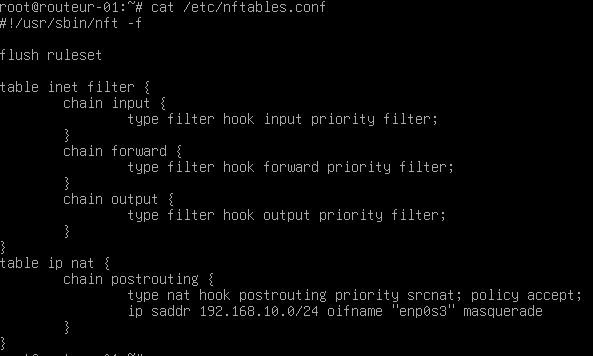
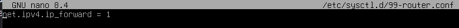
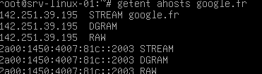
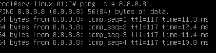
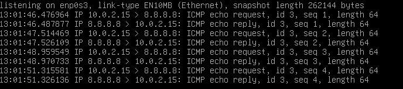

##  Objectif du laboratoire

L'objectif de ce laboratoire est de mettre en place un environnement réseau permettant à une machine située sur un réseau LAN privé d'accéder à Internet via un routeur Linux.

À la fin du LAB, la configuration doit rester fonctionnelle après un redémarrage.

---

#  Architecture de l'infra

```text
                    INTERNET
                       │
                       │
                 10.0.2.2
                       │
                 ┌───────────┐
                 │ ROUTER-01 │
                 │           │
WAN enp0s3 ──────│ 10.0.2.15 │
                 │           │
LAN enp0s8 ──────│192.168.10.1│
                 └───────────┘
                       │
              192.168.10.0/24
                       │
                 ┌──────────────┐
                 │ SRV-LINUX-01 │
                 │ 192.168.10.2 │
                 └──────────────┘
```

---

# Machines  utilisées et caractéristique 

## ROUTER-01

| Élément        | Configuration             |
| -------------- | ------------------------- |
| Rôle           | Routeur Linux (Debian 12) |
| Interface WAN  | `enp0s3`                  |
| Adresse WAN    | `10.0.2.15/24`            |
| Passerelle WAN | `10.0.2.2`                |
| Interface LAN  | `enp0s8`                  |
| Adresse LAN    | `192.168.10.1/24`         |

## SRV-LINUX-01

| Élément          | Configuration             |
| ---------------- | ------------------------- |
| Rôle             | Serveur Linux (Debian 12) |
| Interface réseau | `enp0s3`                  |
| Adresse IP       | `192.168.10.2/24`         |
| Passerelle       | `192.168.10.1`            |
| DNS              | `1.1.1.1`                 |

---
# 1. Vérification du routage IPv4

Le routeur possède :

- une interface WAN connectée au réseau extérieur `10.0.2.2` ;
- une interface LAN connectée au réseau `192.168.10.0/24` ;
- une route par défaut vers la passerelle WAN.

Le routage IPv4 doit être activé sur Routeur-01 pour permettre de transmettre les paquets entre ses interfaces LAN-WAN.

---

# 2. Activation du routage IPv4 sur ROUTER-01

Paramètre a activé :

```text
net.ipv4.ip_forward
```

Activation temporaire du routage :

```bash
sysctl -w net.ipv4.ip_forward=1
```


Vérification via :
```bash
cat /proc/sys/net/ipv4/ip_forward
```
La résultat attendue est :



---

# 3. Configuration du NAT avec nftables

Le réseau LAN utilise des adresses privées :

```text
192.168.10.0/24
```

Pour permettre aux machines du LAN d'accéder à Internet, une règle NAT de type `masquerade` est utilisée afin de remplacé l'adresse privé par l'adresse WAN du routeur.

La règle se trouve dans une table :

```text
table ip nat
```

avec une chaîne :

```text
chain postrouting
```

La règle NAT utilisée est :

```nft
ip saddr 192.168.10.0/24 oifname "enp0s3" masquerade
```

---

# 4. Configuration persistante de nftables

Le fichier de configuration utilisé est :

```text
/etc/nftables.conf
```

La configuration finale contient :



### Fonctionnement

-  flush ruleset: Efface toutes règles actif dans la mémoire 
-  table : conteneur permettant de regrouper des chaînes et des règles.
- `inet` : famille permettant de traiter les paquets IPv4 et IPv6.
-  `ip` : famille destinée au traitement des paquets IPv4.
-  `filter` et `nat` : noms des tables. Ce sont des noms choisis par l'administrateur, généralement selon leur fonction.
-  `chain input` : traite les paquets destinés directement à la machine locale. 
-  `chain forward` : traite les paquets qui traversent le routeur pour rejoindre une autre machine.
- `chain output` : traite les paquets générés directement par la machine locale.
-  `type filter` : définit une chaîne de filtrage de paquets.
-  `hook input` : rattache la chaîne au point de traitement des paquets entrants destinés à la machine locale.
-  `hook forward` : rattache la chaîne au point de traitement des paquets transférés vers une autre machine.
-  `hook output` : rattache la chaîne au point de traitement des paquets générés localement.
- `hook postrouting` : rattache la chaîne au point de traitement POSTROUTING.
- `priority` : détermine l'ordre dans lequel les chaînes associées à un même hook sont exécutées.
- `policy accept` : définit le comportement par défaut. Si aucune règle ne donne un verdict différent, le paquet est accepté.
- `chain postrouting` : chaîne intervenant après la décision de routage, juste avant la sortie du paquet.
- `type nat` : définit une chaîne dédiée au traitement NAT.
- `ip saddr 192.168.10.0/24` : trafic provenant du LAN ;
- `oifname "enp0s3"` : trafic sortant par l'interface WAN ;
- `masquerade` : traduction de l'adresse IP privée source en adresse IP du routeur.

---

## Vérification de la syntaxe

Avant le chargement :

```bash
nft -c -f /etc/nftables.conf
```

Puis chargement :

```bash
nft -f /etc/nftables.conf
```

Vérification :

```bash
nft list ruleset
```

---

# 5. Persistance du routage IPv4

Après un premier redémarrage, un problème a été identifié : le NAT était chargé, mais `ip_forward` était revenu à `0`.

La solution est de crée un fichier dans le répertoire /etc/sysctl.d afin de rendre le routage ipv4 persistant:

```text
/etc/sysctl.d/99-router.conf
```


Application :
```bash
sysctl --system
```

---

# 6. Validation finale avec SRV-Linux-01


 Preuve 1 — Accès Internet depuis SRV-LINUX-01 via routeur-01


Preuve 2 — DNS fonctionne



Preuve 3 — le NAT est bien effectué

Avec tcpdump on écoute l'interface WAN du routeur


Puis nous allons ping 8.8.8.8 via SRV-Linux-01



Voici le résultat



On peut voit que l'IP out est bien celle de la patte WAN du routeur

# Conclusion

Le LAB 01 est entièrement fonctionnel.

L'infrastructure finale permet à `SRV-LINUX-01`, situé sur le réseau privé :

```text
192.168.10.0/24
```

d'accéder à Internet via `ROUTER-01`.

La configuration est persistante après redémarrage :

```text
nftables : ok 
NAT : ok 
masquerade : ok 
ip_forward : ok
accès Internet : ok 
DNS : ok
```

#  LAB 01 — TERMINÉ


Au cours de ce laboratoire, les compétences suivantes ont été mises en pratique :

- Analyse des interfaces réseau Linux ;
    
- Lecture des tables de routage ;
    
- Configuration d'une passerelle ;
    
- Diagnostic réseau avec `ip`, `ping` et `getent`,`Traceroute` ;
    
- Compréhension du routage IPv4 ;
    
- Activation de `ip_forward` ;
    
- Utilisation de `nftables` ;
    
- Configuration du NAT ;
    
- Utilisation de `masquerade` ;
    
- Persistance des règles firewall ;
    
- Persistance des paramètres kernel avec `sysctl` ;
    
- Tests de connectivité LAN → Internet ;
    
- Configuration et diagnostic DNS ;
    
- Validation d'une infrastructure après redémarrage.
