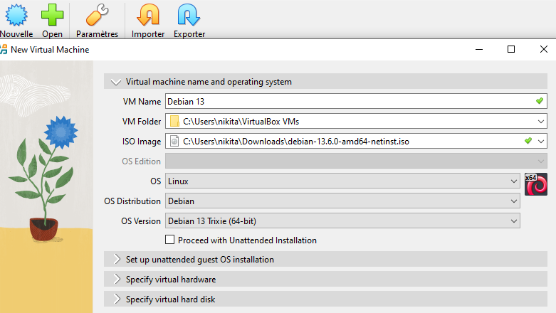
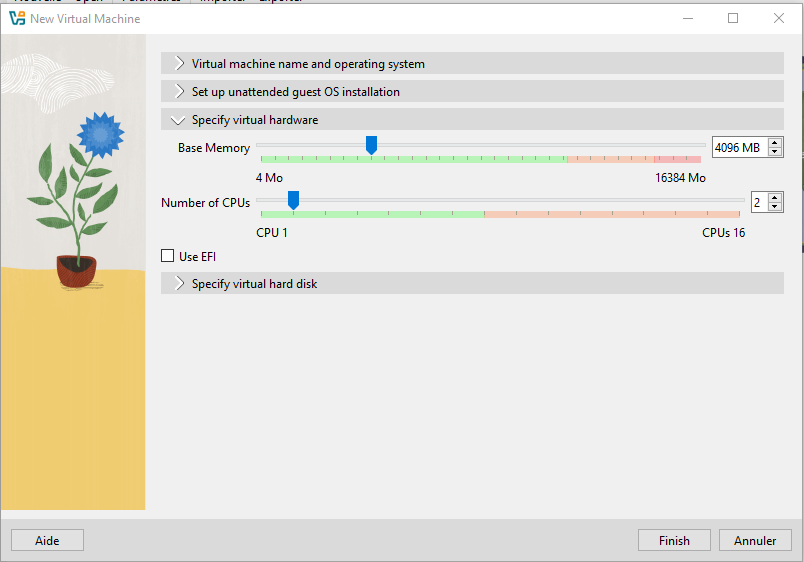
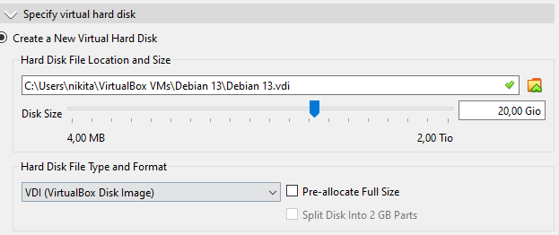
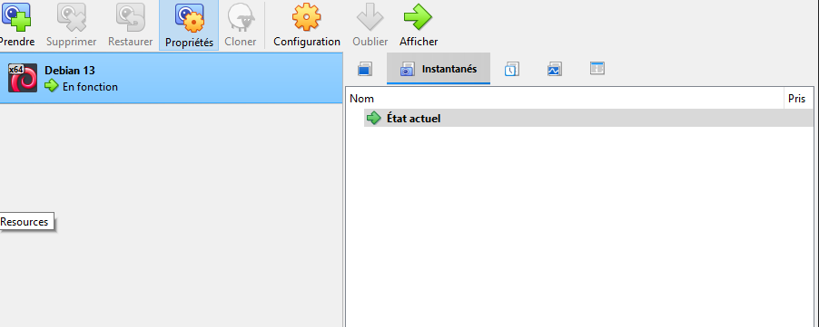
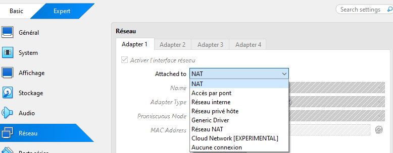

# LAB 01 — Installer une machine virtuelle Debian

> **Parcours :** Administration système & infrastructure  
> **Niveau :** Débutant · **Statut :** Terminé  
> **Environnement :** VirtualBox · Debian 13

---

##  Objectif

Découvrir la virtualisation et préparer une machine virtuelle Debian 13 afin de disposer d'un environnement de test isolé.

##  Contexte

Un administrateur système doit tester ses serveurs et ses configurations avant leur mise en production. VirtualBox permet de déployer rapidement une machine virtuelle sur un ordinateur, afin de réaliser ces tests sans mettre en danger l'infrastructure réelle de l'organisation.

##  Notions essentielles

### Machine virtuelle (VM)

Une machine virtuelle est une machine simulée à l'intérieur d'une machine physique. Elle dispose de ses propres ressources — processeur, mémoire vive et espace disque — qui sont allouées à partir de la machine hôte.

### Hyperviseur

Un hyperviseur permet de créer et d'exécuter des machines virtuelles. Il existe deux grands types d'hyperviseurs :

| Type | Fonctionnement | Exemples |
|---|---|---|
| **Type 1 — natif** | Installé directement sur le matériel, sans système d'exploitation hôte intermédiaire. | Proxmox VE, VMware ESXi |
| **Type 2 — hébergé** | Fonctionne comme une application au sein d'un système d'exploitation existant. | VirtualBox, VMware Workstation |

Un hyperviseur de type 1 offre généralement de meilleures performances et une latence plus faible. Un hyperviseur de type 2 est simple à installer et pratique pour les environnements de test et d'apprentissage.

### Snapshot (instantané)

Un snapshot enregistre l'état d'une machine virtuelle à un instant donné. Il permet de revenir à cet état en cas d'erreur ou après une manipulation.

---

##  Mise en pratique

### 1. Préparer l'installation

- Télécharger l'image ISO du système d'exploitation souhaité.
- Pour ce laboratoire, utiliser **Debian 13**.
- Ouvrir VirtualBox.

### 2. Créer la machine virtuelle

1. Cliquer sur **Nouvelle** dans VirtualBox.
2. Sélectionner l'image ISO de Debian 13.
3. Attribuer les ressources nécessaires à la machine virtuelle (mémoire vive, processeurs et disque virtuel).
4. Finaliser la création de la VM.

### 3. Créer un snapshot

Créer un snapshot de la machine virtuelle afin de sauvegarder un état de référence et de pouvoir y revenir en cas de problème.

### 4. Configurer le réseau

Accéder aux paramètres réseau de la machine virtuelle et examiner/configurer le mode réseau adapté à l'environnement de test.

---

##  Captures d'écran

Ajouter les captures dans le dossier `images/` du laboratoire, puis remplacer les chemins ci-dessous par les noms de fichiers correspondants.

| Étape | Capture |
|---|---|
| Création de la VM |   |
| Attribution des ressources |  |
| Attribution disque dur |  | 
| Création du snapshot |  |
| Paramètres réseau |  |

<!--
Exemple pour afficher une capture :

-->

---

## Validation du laboratoire

- [x] Comprendre le principe d'une machine virtuelle.
- [x] Distinguer un hyperviseur de type 1 et de type 2.
- [x] Créer une machine virtuelle Debian 13 dans VirtualBox.
- [x] Attribuer des ressources à la VM.
- [x] Créer un snapshot.
- [x] Accéder aux paramètres réseau.

##  Bilan

Ce laboratoire a permis de découvrir les bases de la virtualisation avec VirtualBox et de préparer une machine Debian 13 destinée aux prochains travaux pratiques.

**Compétences travaillées :** virtualisation, création de VM, allocation des ressources, snapshots et configuration réseau.

---

*Fin du LAB 01 — Prêt pour la suite du parcours.*
